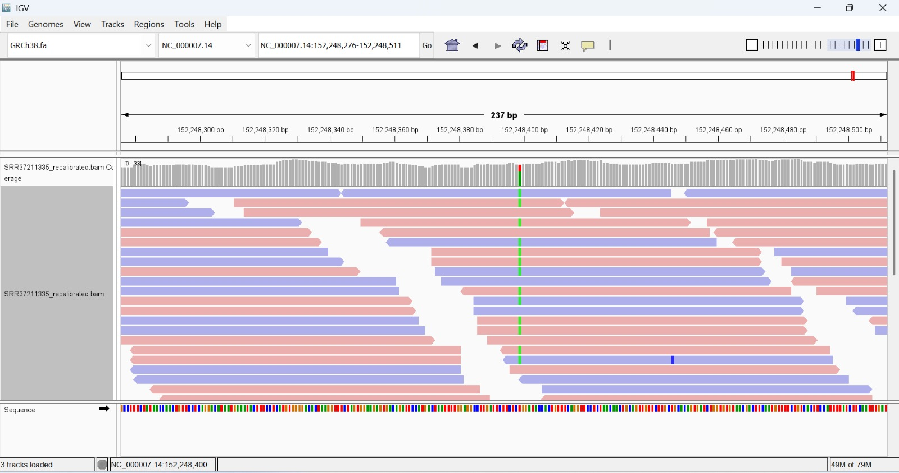

# TNBC Whole Exome Sequencing (WES) Analysis

## Project Overview

This project focuses on tumour-only Whole Exome Sequencing (WES) data analysis of a Triple-Negative Breast Cancer (TNBC) sample using bioinformatics tools and a GATK best-practice-based workflow.

## Dataset Information

| Parameter | Details |
|---|---|
| BioProject | PRJNA1422845 |
| SRA Study | SRP676624 |
| SRA Run | SRR37211335 |
| Sample | WES_Tumor_01 |
| Reference Genome | GRCh38 |

## Aim

To identify and functionally annotate genetic variants in TNBC tumour WES data and investigate selected candidate variants.

## Bioinformatics Workflow

1. **FASTQ Quality Control:** FastQC
2. **Read Preprocessing:** fastp
3. **Quality Report Aggregation:** MultiQC
4. **Read Alignment:** BWA-MEM
5. **BAM Processing:** SAMtools
6. **Duplicate Marking:** Picard
7. **Base Quality Score Recalibration:** GATK BQSR
8. **Somatic Variant Calling:** GATK Mutect2
9. **Contamination Estimation:** GetPileupSummaries and CalculateContamination
10. **Variant Filtering:** FilterMutectCalls
11. **Functional Annotation:** Ensembl VEP
12. **Candidate Variant Review:** IGV

## Workflow Diagram

## BAM Processing and Alignment Results

BAM processing was performed using SAMtools, Picard and GATK.

| Parameter | Result |
|---|---:|
| Total alignment records | 44,198,569 |
| Primary alignment records | 44,082,430 |
| Mapping rate | 99.98% |
| Properly paired reads | 98.72% |
| Duplicate-marked reads | 3,048,252 |
| Duplicate rate | 6.92% |

### Target Coverage Results

| Parameter | Result |
|---|---:|
| Mean target depth | 54.41× |
| Target bases covered at ≥1× | 99.15% |

## Variant Calling and Annotation Results

Variant calling was performed using GATK Mutect2, followed by filtering and functional annotation with Ensembl VEP.

| Parameter | Result |
|---|---:|
| PASS variant records | 983 |
| HIGH-impact VEP records | 18 |
| Unique genes with HIGH-impact records | 17 |
| Frameshift | 8 |
| Stop-gained | 7 |
| Splice donor | 3 |

*Note: HIGH-impact consequences represent predicted effects on protein function and do not independently establish pathogenicity or driver status.*

## Candidate Variant Analysis

### BRIP1

- **Variant:** `NM_032043.3:c.1794+1G>A`
- **rsID:** rs766516963
- **Consequence:** Splice donor
- **IGV read depth:** 25
- **Alternate allele reads:** 22
- **Variant allele frequency:** Approximately 88%
- **ClinVar:** Pathogenic/Likely Pathogenic germline submissions.

The ClinVar classification is based on germline evidence. Its somatic status in this tumour cannot be established from tumour-only analysis.

### KMT2C

- **Variant:** `c.2035A>T`
- **Protein change:** `p.Arg679Ter`
- **Consequence:** Stop-gained
- **IGV read depth:** 26
- **Alternate allele reads:** 18
- **Variant allele frequency:** Approximately 69.23%

CIViC contains gene-level evidence related to KMT2C loss and treatment response in other cancer contexts. This does not establish variant-specific actionability in TNBC.

## IGV Visualization

IGV was used to inspect read-level support for the selected candidate variants.

## IGV Visualization

### BRIP1

### KMT2C

## Tools and Technologies

| Category | Tools |
|---|---|
| Quality Control | FastQC, fastp, MultiQC |
| Alignment | BWA-MEM |
| BAM Processing | SAMtools, Picard |
| Variant Calling | GATK Mutect2 |
| Variant Annotation | Ensembl VEP |
| Visualization | IGV |
| Variant Databases | ClinVar, VarSome, OncoKB, CIViC |
| Environment | Linux, Bash |

## Limitations

- This analysis was performed using tumour-only sequencing data; matched normal data was not available for the analysis.
- Somatic and germline variants cannot be reliably distinguished without matched normal data.
- Predicted HIGH-impact variants require further clinical and biological interpretation.
- IGV read-level support alone does not establish clinical pathogenicity.

## Conclusion

The TNBC WES analysis successfully processed sequencing reads, achieved a high mapping rate, and identified 983 PASS variant records. Functional annotation identified 18 HIGH-impact records across 17 genes. BRIP1 and KMT2C were selected.
